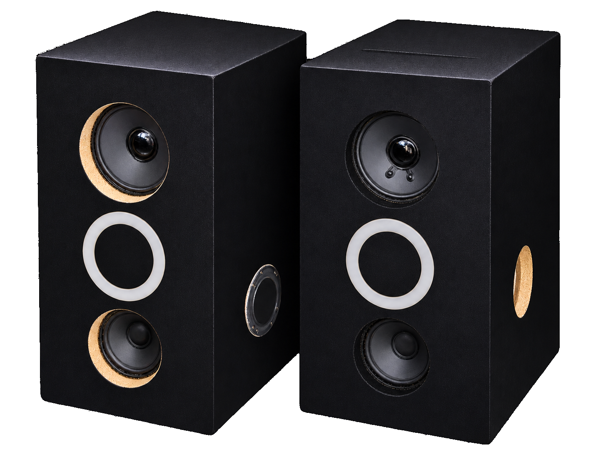

<p align="center">
  
</p>

<h1 align="center">dualbeast</h1>
<p align="center"><strong>Two Speakers. One Powerful Experience.</strong></p>

<p align="center">
  <a href="https://ais-pre-edsqprhsgz4rauczxcnnro-333090817686.asia-southeast1.run.app/dualbeast">
    
  </a>
  <a href="https://react.dev">
    
  </a>
  <a href="https://kno.wled.ge">
    
  </a>
</p>

**dualbeast** is an interactive 3D showcase and hardware documentation site for a custom, hand-built **DIY Party Box** wireless stereo speaker pair designed and built by **Rajdeep Bhattacharyya**. The system pairs two independent MDF speaker cabinets wirelessly as dedicated **Left (L)** and **Right (R)** channels, combining physical acoustic engineering, sound-reactive **WLED** lighting driven by an **ESP32** and **INMP441** I2S digital microphone, and real-time 3D WebGL inspection.

---

## 🌐 Live Showcase

- **Production URL:** [https://ais-pre-edsqprhsgz4rauczxcnnro-333090817686.asia-southeast1.run.app/dualbeast](https://ais-pre-edsqprhsgz4rauczxcnnro-333090817686.asia-southeast1.run.app/dualbeast)
- **Canonical Route:** `/dualbeast`
- **Tagline:** *Two Speakers. One Powerful Experience.*

---

## 🔊 Speaker Architecture & Key Highlights

Each cabinet in the stereo pair is hand-built from **MDF board** wrapped in a matte black textured finish and damped internally with synthetic cotton:

| Parameter | Specification |
| :--- | :--- |
| **Cabinet Dimensions** | `15 cm (W) × 14.7 cm (D) × 27.5 cm (H)` per speaker (`781:1491` front aspect ratio) |
| **Upper Driver Cutout** | `Ø 7 cm` active mid/high driver on the upper front baffle |
| **Middle Lighting Halo** | `16-LED` addressable RGB ring behind a frosted diffuser (`ESP32` + `WLED`) |
| **Lower Woofer Cutout** | `Ø 5 cm` front low-frequency woofer |
| **Bass Extension** | Side-mounted passive radiator on each cabinet (`Left` & `Right`) |
| **Audio Reactivity** | `INMP441` I2S MEMS digital microphone feeding live audio into the `ESP32` |
| **Battery & Power** | Internal `6000 mAh` lithium battery pack with `BMS`, `INA219` I2C power sensor, `USB-C` charging, and `12V DC` direct input |
| **Controls & Wireless** | Top capacitive touch pads (`Play/Pause`, `Next/Prev`, `3–5s Hold` stereo link), `Bluetooth`, and tap-to-pair `NFC` |

---

## 🧩 Featured Parts & Controls Guide (6 Interactive Plates)

1. **WLED Lighting & Battery Indicator** — 16 addressable RGB LEDs behind a frosted diffuser ring controlled by an ESP32 running WLED. Displays battery level on startup (`Green` 100%, `Yellow` ~50%, `Orange` ~25%, `Red` <20%) and flashes warnings at `<15%`, `<10%`, and `<5%` before entering deep sleep.
2. **Cabinet Dimensions & MDF Build** — `15 × 14.7 × 27.5 cm` MDF enclosure with `Ø 7 cm` upper driver and `Ø 5 cm` lower woofer cutouts, finished in matte textured black wrap.
3. **Side-Mounted Passive Radiators** — Dedicated side passive radiator on each cabinet reacting to internal air pressure from the front drivers to deepen low-end bass without port wind noise.
4. **Rear Switches, Ports & Red Buttons** — Master power toggle, USB-C charging port, 12V DC input, ESP32 programming port, and two multi-function red push buttons:
   - **Button 1 (WLED Control):** Single press = ON/OFF · Double press = Change color · Triple press = Next effect.
   - **Button 2 (Power & Battery):** Single press = Battery % on LED ring · Double press = Live power draw (`INA219`) · Hold 5s = Deep sleep.
5. **Top Touch Controls, Bluetooth & NFC** — Capacitive touch pads on top of both cabinets (`Single Tap` = Play/Pause, `Double Tap` = Next/Previous Track, `Touch & Hold 3–5s` = Both-Speaker Stereo Mode ON/OFF) plus tap-to-pair NFC.
6. **INMP441 (I2S MEMS Digital Microphone)** — Captures surrounding audio and streams it to the ESP32 over I2S so WLED synchronizes RGB lighting effects with beats and music without requiring a direct wired tap into the amplifier.

---

## 🛠️ Complete 16-Component Bill of Materials

| # | Category | Component | Description |
| :--- | :--- | :--- | :--- |
| `01` | Audio Input | **Digital Microphone — INMP441** | I2S digital microphone that picks up room audio for music-reactive lighting. |
| `02` | Power Monitoring | **Voltage & Current Sensor — INA219** | I2C sensor board that measures battery voltage and current draw. |
| `03` | Microcontroller | **ESP32 Development Board** | Microcontroller running WLED and reading the microphone and power sensor. |
| `04` | Lighting Control | **WLED — Addressable RGB LED Control** | Firmware driving the front 16-LED addressable RGB ring. |
| `05` | Audio Amplification | **Amplifier** | Class-D stereo amplifier board driving the speakers. |
| `06` | Acoustic Drivers | **Speakers** | 7 cm upper driver, 5 cm lower woofer, and side-mounted passive radiator. |
| `07` | Electrical Connections | **Internal Wiring** | Hand-soldered wiring connecting the battery, amplifier, sensors, switches, and drivers. |
| `08` | Power Control | **Power Switch** | Rear toggle switch for main power. |
| `09` | Power Input | **DC Power Socket** | Rear 12V DC input jack for external power. |
| `10` | Auxiliary Input | **3.5mm Female Audio Jack** | 3.5 mm stereo aux input for wired audio playback. |
| `11` | Battery Pack | **6000mAh Battery** | Internal 6000 mAh lithium battery pack for portable use. |
| `12` | Battery Protection | **BMS — Battery Management System** | Protection board for charging, cell balancing, and low-voltage cutoff. |
| `13` | Crossover Filter | **Polyester Film Capacitor** | Inline film capacitor used as a simple passive crossover filter. |
| `14` | Wireless Audio | **Bluetooth Audio Receiver — Salvaged from AirPods** | Salvaged Bluetooth audio receiver wired in for wireless playback. |
| `15` | Cabinet Finish | **Textured Cabinet Wallpaper** | Matte textured wrap covering the MDF cabinet. |
| `16` | Internal Damping | **Synthetic Cotton — Acoustic Damping** | Synthetic cotton fill inside the cabinet to damp internal reflections. |

---

## ✨ Interactive Website Features

- **Interactive X-Ray Hero & Brand Lockup:** Move the cursor (or watch the autonomous sweep) across the front speaker render to reveal internal driver leveling callouts and cutaway anatomy.
- **3D Model Inspector (`Left` & `Right` GLB Viewports):** Orbit, zoom, inspect exploded views, and download the binary glTF 2.0 (`.glb`) reconstructions of both speakers, backed by a deterministic 2D/turntable fallback renderer when hardware WebGL is unavailable.
- **Virtual WLED Studio:** Browser-based simulation of the 16-LED ring supporting 10 WLED effects, 8 color palettes, custom HSV color wheel selection, brightness/speed sliders, and `Left + Right` stereo sync.
- **Responsive Parts Guide:** Horizontal parallax blueprint canvas on desktop and a smooth horizontal snap-swipe deck on mobile (`< 1024px`) with detailed component modals.
- **Opposing Split-Screen Counter-Wipe:** Scrubs smoothly from 45° angled stereo CAD outlines into the night balcony setup photo and the 16-item internal hardware breakdown.
- **Build Photo & Video Gallery:** High-efficiency H.264 (`faststart`) bass excursion and WLED lighting test videos alongside build photography.

---

## 📂 Repository Structure

```text
.
├── index.html                  # App entry point, favicon links, OpenGraph/Twitter cards & JSON-LD
├── metadata.json               # Application metadata
├── package.json                # Scripts & dependencies
├── public/
│   ├── apple-touch-icon.png    # 180×180 speaker outline touch icon
│   ├── favicon.svg             # Vector 781:1491 speaker outline favicon
│   ├── favicon-32x32.png       # 32×32 PNG favicon
│   ├── favicon-16x16.png       # 16×16 PNG favicon
│   ├── favicon.ico             # Multi-size ICO favicon
│   ├── og-dualbeast.png        # 1200×630 social link preview card
│   ├── site.webmanifest        # Web App Manifest for /dualbeast
│   ├── speaker.glb             # Base Right speaker glTF 2.0 binary model
│   ├── speaker_photorealistic.glb      # PBR-textured Right speaker GLB
│   ├── left_speaker.glb        # Base Left speaker glTF 2.0 binary model
│   ├── left_speaker_photorealistic.glb # PBR-textured Left speaker GLB
│   ├── assets/
│   │   ├── aistudio/           # Curated speaker & component photographs/cutouts
│   │   ├── renders/            # Studio speaker renders & 360° turntable atlases
│   │   └── textures/           # PBR albedo, normal, roughness & ORM maps
│   └── speaker-gallery/        # Compressed build photos, posters & faststart MP4 videos
├── scripts/                    # Offline GLB & PBR texture generation utilities
└── src/
    ├── App.tsx                 # Root application component
    ├── main.tsx                # React 19 DOM entry point
    ├── index.css               # Tailwind CSS v4 & typography imports
    ├── components/             # UI chapters, 3D inspector, WLED Studio & gallery modals
    ├── kinetic/                # Pure timeline math engines & unit tests (*.test.ts)
    ├── model/                  # Procedural 3D speaker geometry, GLB serializer & tests
    └── wled/                   # 16-LED ring effect engine, shader helpers & tests
```

---

## 🚀 Getting Started (Local Development & Production)

### Prerequisites
- **Node.js** `>= 20.x`
- **npm** `>= 10.x`

### 1. Install Dependencies
```bash
npm install
```

### 2. Start Development Server (Port 3000)
```bash
npm run dev
```
Open `http://localhost:3000/dualbeast` in your browser.

### 3. Run Unit Tests, Typecheck & Production Build
```bash
# Run all 66 unit tests (kinetic timeline, WLED engine, 3D GLB model geometry)
npm test

# Run TypeScript type checking
npm run lint

# Build optimized production bundle to ./dist
npm run build

# Preview production build locally
npm run preview
```

---

## 👤 Creator & Links

Designed and built by **Rajdeep Bhattacharyya**:

- **Instagram:** [@\_rajdeep.007\_](https://www.instagram.com/_rajdeep.007_/)
- **GitHub:** [@rajdeepbhattacharyya25-pixel](https://github.com/rajdeepbhattacharyya25-pixel)
- **LinkedIn:** [rajdeep-bhattacharyya-497945371](https://www.linkedin.com/in/rajdeep-bhattacharyya-497945371/)
- **Buy Me a Coffee:** [buymeacoffee.com/rajdeep.bhattacharyya](https://buymeacoffee.com/rajdeep.bhattacharyya)
